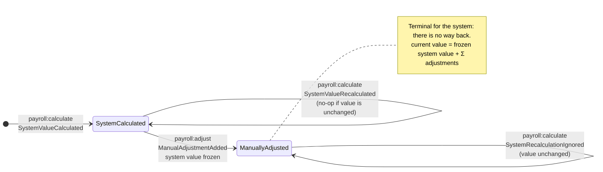
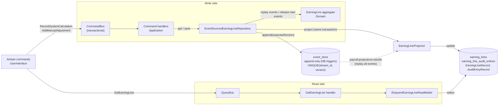

# Earning Line Adjustments

[](https://github.com/maryan86/alcor-os/actions/workflows/ci.yml)

The system calculates an earning line, for example an employee's base salary. A payroll specialist can correct it
with signed manual adjustments, and each adjustment needs a comment. Adjustments are never edited or deleted. The
first one permanently freezes the line, so later system recalculations no longer affect it. The current value and
the full history are always available.

The line is event-sourced: its history of events is the source of truth, and the current value is derived from it.

Two additions go beyond the brief, because a payroll specialist and an auditor need them:

- **A compensating adjustment names the one it fixes:** `--corrects=4` shows up in the history as
  `Adjustment 5 (corrects #4)`, and the domain rejects a reference to an adjustment that does not exist.
- **A line can be shown as it was at any moment:** `payroll:show <line> --as-of="2026-10-29 12:00"`, for example
  the value a specialist saw when a pay period was closed.

## Run

```bash
cp .env.example .env
docker compose up -d --build --wait               # app (PHP 8.5), postgres 18, adminer
docker compose exec app php artisan payroll:demo  # the 8-step example, checked against the expected values
docker compose exec app composer check            # Pint + PHPStan (max) + PHPUnit
docker compose stop                               # `down -v` also drops the data
```

The demo ends with the audit history expected by the assignment:

```
| Entry                 | Value     | Comment                                               |
| System value (frozen) | $1,050.00 |                                                       |
| Adjustment 1          | -$45.55   | Employee declined dental benefit; reversing deduction |
| Adjustment 2          | +$100.10  | Late correction: missed approved overtime bonus       |
| Adjustment 3          | -$0.10    | Minor rounding adjustment                             |
| Adjustment 4          | -$0.20    | Second minor rounding adjustment                      |
| Adjustment 5          | +$0.20    | Correcting mistake in adjustment #4                   |
| Current value         | $1,104.45 |                                                       |
```

| Service | Address |
|---|---|
| `app` | `docker compose exec app …`. Installs vendor if missing and runs migrations on start |
| `postgres` | `127.0.0.1:54330`, `alcor` / `secret`, databases `alcor_payroll` and `alcor_payroll_test` |
| `adminer` | http://127.0.0.1:8082 |

## Usage

```bash
LINE=0b9a5c34-2d0e-4b8f-9a51-6f1d2c3e4a5b
art() { docker compose exec app php artisan "$@"; }

art payroll:calculate $LINE 1050.00                                     # -> $1,050.00
art payroll:adjust $LINE --amount=-45.55 --comment="Declined benefit"   # -> $1,004.45, line frozen
art payroll:calculate $LINE 1100.00                                     # ignored  -> $1,004.45
art payroll:adjust $LINE --amount=-0.20 --comment="Rounding"            # adjustment #2 (a mistake)
art payroll:adjust $LINE --amount=0.20 --comment="Fix #2" --corrects=2  # adjustment #3 compensates #2
art payroll:show $LINE                                                  # value, audit history, event timeline
art payroll:show $LINE --as-of="2026-10-29 12:00"                       # the line as it was at that moment
```

| Command | Purpose |
|---|---|
| `payroll:calculate {line} {amount} [--currency=USD]` | System (re)calculation; the first call creates the line |
| `payroll:adjust {line} --amount= --comment= [--by=] [--corrects=]` | Manual correction: signed, non-zero, comment required; `--corrects` names the adjustment it compensates |
| `payroll:show {line} [--as-of=]` | Current value and full history, optionally as they were at a given moment (UTC) |
| `payroll:projections:rebuild` | Rebuild the read model by replaying the event store |
| `payroll:demo` | Run the assignment scenario; exits non-zero if any value differs from the expected one |

Invalid input is rejected with a domain error and nothing is stored. Examples: a zero amount, a missing comment,
`1.005`, an unknown line, correcting an adjustment that does not exist.

## How it works

### Business rules

| Rule | Enforced by |
|---|---|
| A correction is a signed, non-zero amount with a mandatory comment | `EarningLine::addManualAdjustment()`, `Money`, `AdjustmentComment` |
| Corrections are never edited or deleted | The aggregate has no such behaviour. Events are `readonly`. PostgreSQL triggers reject `UPDATE`, `DELETE` and `TRUNCATE` on `event_store` |
| A mistake is fixed by a compensating correction | A new `ManualAdjustmentAdded` that can name the adjustment it corrects (`correctsAdjustmentNumber`, validated to exist); the history keeps both |
| After the first correction, recalculation never changes the line | `recalculate()` records `SystemRecalculationIgnored`. The freeze holds even if corrections sum to zero |
| Current value and full history are always available | Read model via `GetEarningLine`; can also be rebuilt from events at any time |

### Line lifecycle



### Structure

```
app/
├── Payroll/                               bounded context
│   ├── Domain/EarningLine/                EarningLine aggregate, repository port — pure PHP
│   │   ├── ValueObject/                   EarningLineId, AdjustmentComment, SpecialistId, ManualAdjustment
│   │   ├── Event/                         the four domain events
│   │   └── Exception/
│   ├── Application/
│   │   ├── Command/                       RecordSystemCalculation, AddManualAdjustment (+ handlers)
│   │   ├── Query/                         GetEarningLine (+ handler)
│   │   └── ReadModel/                     read-model port; View/ with the returned DTOs
│   ├── Infrastructure/                    event-sourced repository, projector (events → read model)
│   │   └── ReadModel/                     Eloquent read model; Record/ with the Eloquent models
│   ├── UserInterface/Console/             Command/, Presenter/
│   └── PayrollServiceProvider.php         binds ports to adapters, maps handlers and events
└── Shared/                                shared kernel
    ├── Domain/                            EventSourcing/ (aggregate root, DomainEvent), Money/
    ├── Application/Bus/                   Command/, Query/ bus ports
    ├── Infrastructure/                    SystemClock
    │   ├── Bus/                           dispatcher-based and transactional buses
    │   └── EventSourcing/                 EventSerializer, Projector port; Store/ (DB, in-memory)
    └── SharedServiceProvider.php
```

Dependencies point inwards, enforced by [phpat](https://github.com/carlosas/phpat) rules in PHPStan
(`tests/Architecture`).

### Flow



1. **Write.** A command loads the `EarningLine` aggregate by replaying its events. The aggregate checks the rules
   and records new events. State changes only in `apply()`, the same method that replays history.
2. **Store.** Events are appended only at the expected stream version, with `UNIQUE(stream_id, version)` as a
   backstop. Two simultaneous corrections produce a `ConcurrencyConflict`, not a lost update. Events are stored
   under stable versioned names (`payroll.earning_line.manual_adjustment_added.v1`), not PHP class names.
3. **Project.** In the same transaction the projector updates the read model: the line and its audit entries.
   Each entry records *when*; adjustments also record *who* and *why*.
4. **Read.** Queries read only the read model. It is disposable and can be rebuilt from the event store at any time.

## Decisions

- **Event Sourcing.** The requirement *is* an audit log. Here history is the state itself, not a side table
  that can drift from it.
- **Own small ES kernel instead of Spatie.** Spatie makes aggregates extend a framework class. A few small
  classes keep the domain framework-free and easy to walk through. For production I would evaluate
  EventSauce or Ecotone (snapshots, upcasting, async projections).
- **Laravel and PostgreSQL, although the brief says no framework is needed.** They supply only wiring: DI,
  buses, migrations, a real transactional event store. The model and its unit tests are plain PHP and run
  without a database (`vendor/bin/phpunit --testsuite Unit`).
- **Money** is stored as integer minor units. Parsing rejects excess decimals and arithmetic guards against
  overflow. No floats.
- **Ignored recalculations are recorded**, so auditors see when source data diverged from the frozen value.
- **Synchronous projection** gives strong consistency, which is enough for a PoC. At scale this would be an
  outbox with async projectors.
- **Point-in-time view** (`--as-of`): every audit entry keeps the value after it, so the line can be shown exactly
  as a specialist saw it when a pay period was closed.
- **CLI only**, as the brief asks. An HTTP API would be a thin controller over the same buses.

## Assumptions

- A line is created by its first system calculation. Adjusting an unknown line is an error.
- An adjustment is in the line's currency and is non-zero. The comment is required (max 500 chars).
  The author is a free-form id because auth is out of scope.
- Adjustment numbers are sequential per line. Linking a compensating correction to the one it fixes is optional;
  the arithmetic does not depend on it.
- The current value may become negative.

## Tests

79 PHPUnit tests, with no mocks of the domain:

- **Unit:** aggregate in given/when/then style (including the assignment example and replay), handlers on an
  in-memory store, `Money` edge cases, event serialization.
- **Feature (PostgreSQL):** the 8 steps and final history, point-in-time views, concurrency conflict, append-only
  triggers, transactional rollback, projection rebuild, Artisan commands.
- **Architecture:** layering rules in PHPStan.

## Working with AI

The brief encourages AI tools, so here is how this solution was built. I worked with Claude Code as a pair
programmer: it researched options, wrote most of the code and tests from my instructions and ran every check after
each change. The design decisions and the review were mine.

**Decided by me:**
- event sourcing instead of a state table, because the requirement is an audit trail;
- a small own ES kernel instead of Spatie, so the domain stays framework-free;
- PostgreSQL with append-only triggers, and recording ignored recalculations as events;
- one earning line as the aggregate: its system value and all its adjustments are kept consistent together;
- a command-line interface only, as the brief asks, with no HTTP API or UI;
- two features beyond the brief: `--corrects` links a compensating adjustment to the one it fixes,
  and `--as-of` shows a line as it was at any past moment.

**How it was verified:** nothing was kept without PHPStan at max level with the layering rules, the PHPUnit suite
against real PostgreSQL and the demo that checks every value from the assignment.
CI runs the same steps.
